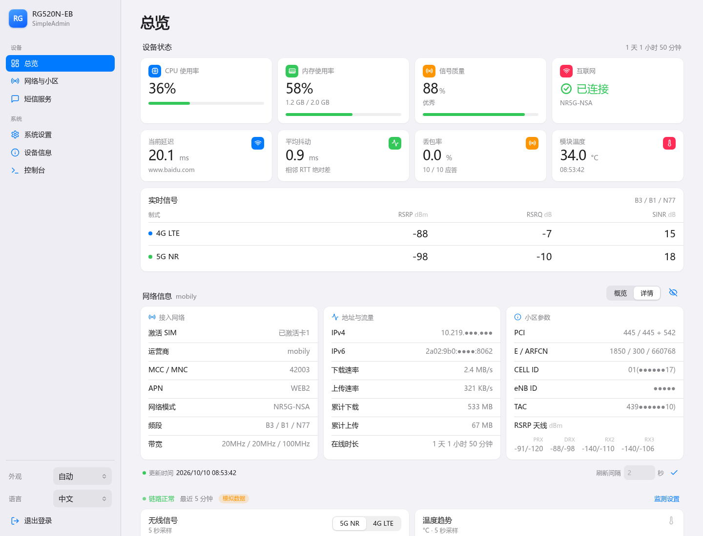
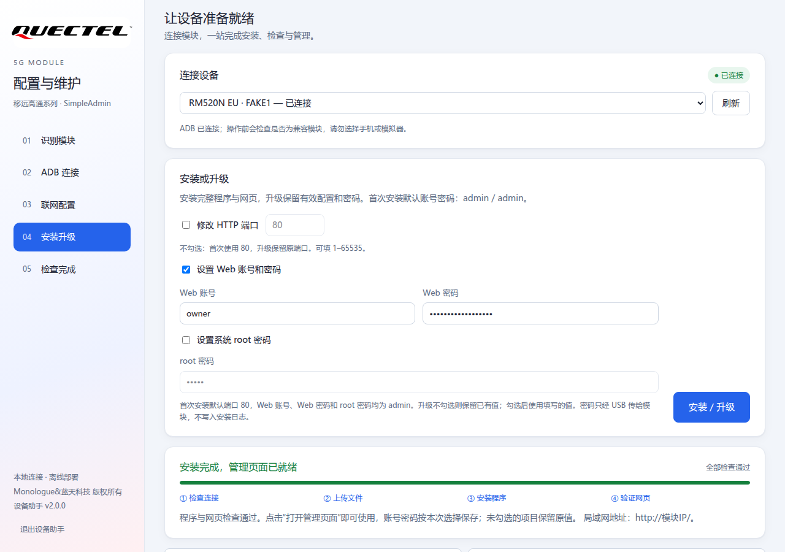
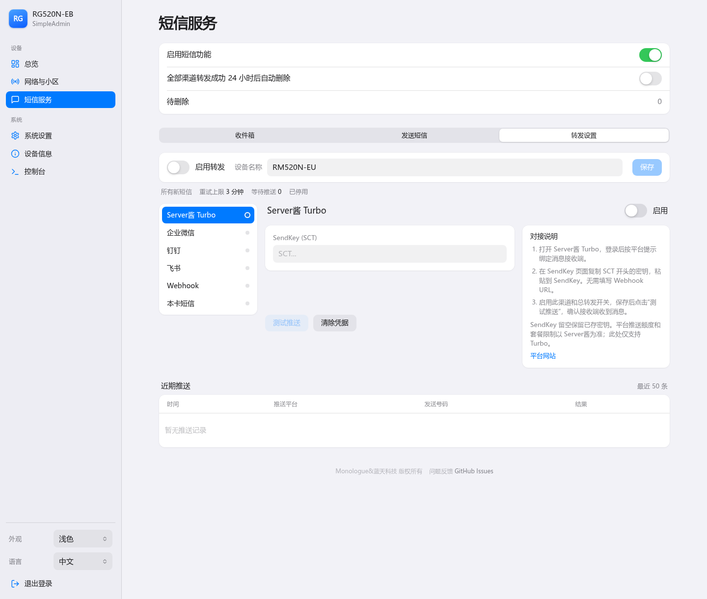
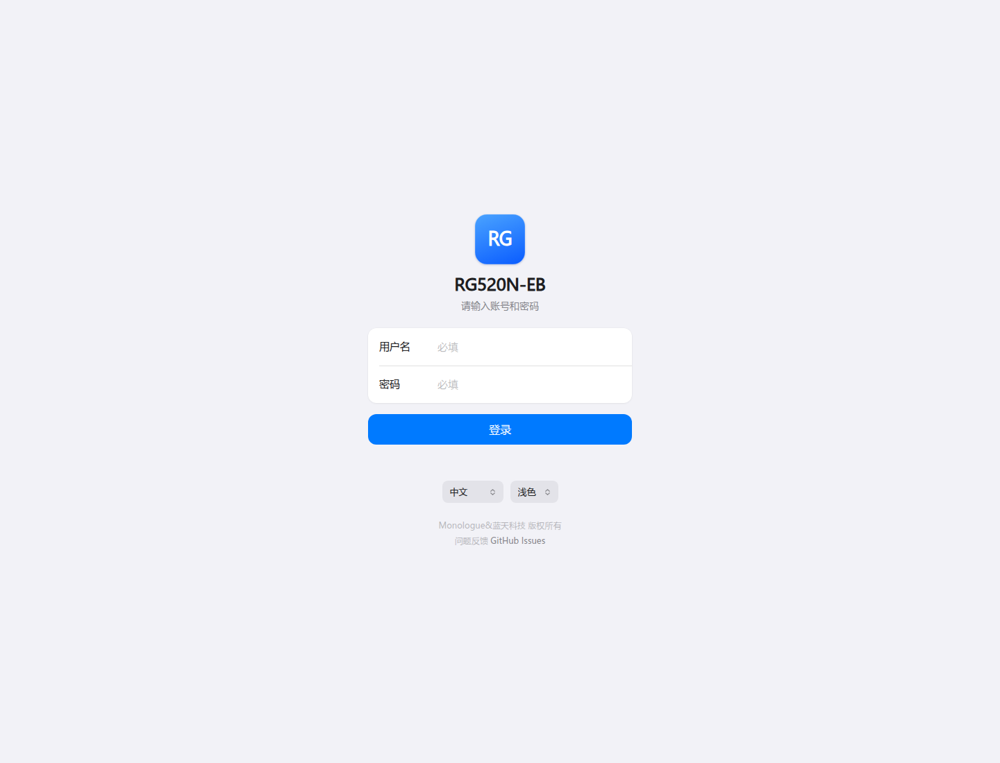
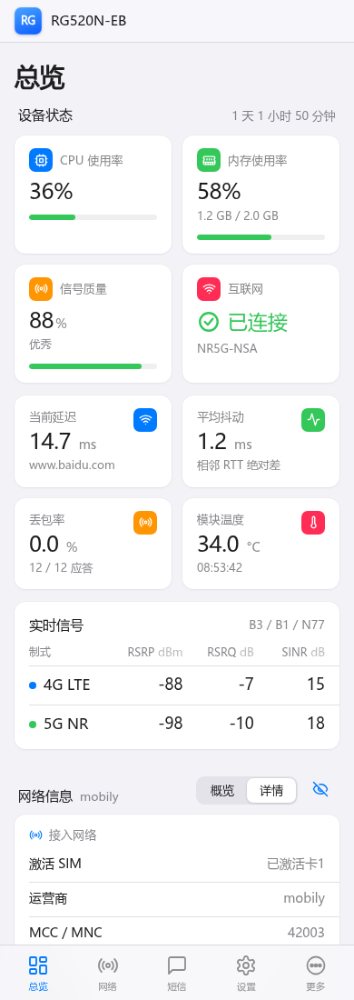
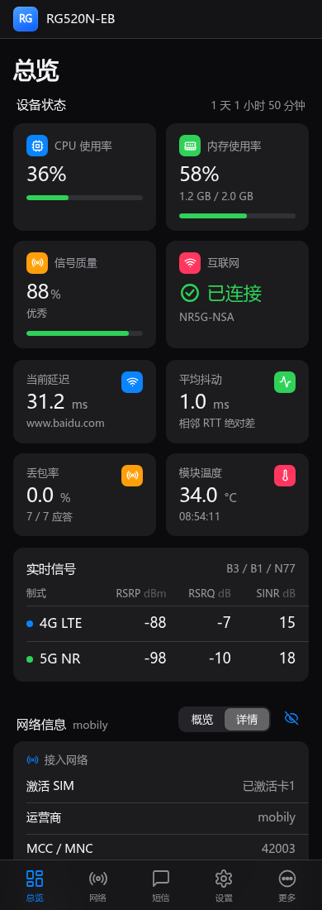
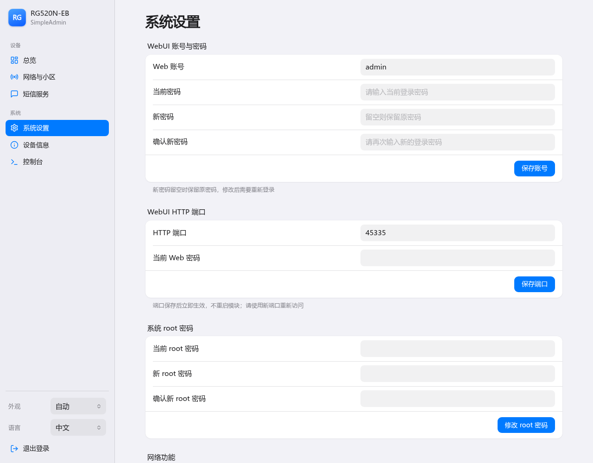

# Quectel RGMII Toolkit · Rust

移远 RM520N 等 5G 模块的轻量管理后台。Rust 原生后端，直接运行在模块上，提供信号监测、频段 / 5G 频点 / 小区锁定、短信与断网恢复通知、断网自动恢复和在线更新，界面支持中文和 English。

[**下载最新版**](https://github.com/tcpqueue/quectel-rgmii-toolkit-Rust/releases/latest) · [更新记录](CHANGELOG.md) · [文档](#文档) · [Go 原项目](https://github.com/snjzb/quectel-rgmii-toolkit-Go)

> 已在 RM520N-EU（RM520NEUDAR03A08M4G）真机安装测试，其他型号和固件尚未实机验证。截图使用模拟数据。

## 功能

| 分组 | 页面 | 内容 |
| --- | --- | --- |
| 设备 | 总览 | 网络状态、频段、小区、信号与天线读数，CPU、内存、流量；信号、温度、流量和延迟的五分钟趋势 |
| | 网络事件 | 制式与小区切换、断网与恢复、锁定保护和看门狗的每一步，最近 200 条 |
| 网络 | 频段与频点 | 频段锁定；5G 频点锁定（严格校验、临时 / 持久）；两者都有 30 秒无信号自动恢复；运营商配置（MBN） |
| | 小区锁定 | 邻区扫描与完整扫描（后台进行，结果保留 10 分钟）；临时 / 持久小区锁定及三分钟拨号失败回退 |
| | 拨号与 SIM | APN 与网络模式；PDP 上下文；IMS/VoLTE、SIM 热插拔、数据漫游、SIM 卡槽 |
| 消息 | 短信 | 收件箱、长短信发送 |
| | 消息通知 | Server酱、企业微信、钉钉、飞书、Webhook、本卡短信；短信转发和断网恢复通知分别选择渠道 |
| 系统 | 断网恢复 | 看门狗：重新注册、重启射频、切换卡槽、重启模块，每级可单独关闭 |
| | 网络功能 | IP 透传、USB 网络模式、DMZ、LAN IP、IMEI、DNS 代理、TTL |
| | AT 终端 · 系统设置 | AT 命令与 AT 队列（执行中、等待中、最近 30 秒的指令和返回内容）；Web 账号密码与端口、root 密码、语言、在线更新、重启 |
| | 设备信息 · 控制台 | 型号、固件版本、SIM 与设备标识；root 网页终端 |

界面为苹果风格：电脑上是侧边栏，手机上是底部标签栏加页顶子菜单，外观可选自动、浅色、深色。所有网页资源随程序提供，不加载外部字体或脚本。

## 安装

1. 下载 [`SimpleAdmin-Setup.exe`](https://github.com/tcpqueue/quectel-rgmii-toolkit-Rust/releases/latest)（Windows 10 / 11 x64）。单个 EXE 已内置 ADB、模块程序和网页，不需要联网。
2. 用 USB 连接模块，双击 EXE，浏览器会打开设备助手。选择模块，点击 **安装 / 升级**，等待检查通过。
3. 浏览器访问模块地址，通常是 `http://192.168.225.1`，默认账号密码 `admin / admin`。

- 需要其他端口时，安装前打开“修改 HTTP 端口”；不改时首次安装用 `80`，升级保留原端口。
- 模块 IP 打不开时，可在设备助手中点 **打开管理页面**，通过 USB（ADB 转发）访问；或在设备助手中运行 **故障诊断**，见 [安装排查](docs/install-troubleshooting.md)。
- 模块还没有开启 ADB 时，设备助手可通过 AT 串口开启 ADB 并配置联网方式，见 [设备助手说明](docs/windows-assistant.md)。

## 升级

| 当前版本 | 方法 |
| --- | --- |
| v0.4.0 及以上 | 管理后台 **系统设置 → 在线更新**，检查并立即更新。默认经 `https://ghfast.top/` 代理访问 GitHub，安装包须通过 Ed25519 签名校验。详见 [在线更新](docs/ota.md)。 |
| v0.3.1 及以下，或 Go 版 | 用设备助手 **安装 / 升级**，无需先卸载；账号密码、端口、TTL 和监测设置保留。 |

## 截图

| 信号与延迟趋势 | 短信转发 | 首次登录与语言 |
| --- | --- | --- |
|  |  |  |

| 手机 · 浅色 | 手机 · 深色 | 网页设置 |
| --- | --- | --- |
|  |  |  |

## 资源占用

在 RM520N-EU 上实测（v0.1.0 基线），后台采样时 CPU 约 0.45%，内存（PSS）约 1.4 MiB；当前 ARM 程序约 5 MB。程序直接读写 AT 口 `/dev/smd11`，不依赖其他辅助进程；趋势数据只在内存中，设置内容不变时不写 NAND。详见 [资源与存储](docs/resource-optimizations.md)。

## 文档

| 主题 | 文档 |
| --- | --- |
| Windows 设备助手：开启 ADB、联网配置、端口、支持型号 | [windows-assistant.md](docs/windows-assistant.md) |
| 安装后打不开网页 | [install-troubleshooting.md](docs/install-troubleshooting.md) |
| 在线更新 | [ota.md](docs/ota.md) |
| 小区锁定、扫描、频段锁定保护、MBN | [sms-cell-lock.md](docs/sms-cell-lock.md) |
| 5G 频点锁定 | [frequency-lock.md](docs/frequency-lock.md) |
| 消息通知：短信转发与断网恢复通知 | [notifications.md](docs/notifications.md) |
| 断网自动恢复（看门狗） | [watchdog.md](docs/watchdog.md) |
| 短信收发与兼容性 | [sms.md](docs/sms.md) · [sms-compatibility.md](docs/sms-compatibility.md) |
| 五分钟趋势、延迟监测与网络事件 | [monitoring.md](docs/monitoring.md) |
| 流量统计 | [traffic.md](docs/traffic.md) |
| 安全设计 | [security.md](docs/security.md) |
| 资源与存储 | [resource-optimizations.md](docs/resource-optimizations.md) |
| 真机验证记录 | [validation.md](docs/validation.md) |
| 构建、测试与打包 | [build.md](docs/build.md) |

## 开发

构建与打包见 [docs/build.md](docs/build.md)。WSL 中请在 Linux 原生目录（如 `~/projects/`）构建。

只想预览页面时，在 Windows 上双击 `windows-test/start.bat`，打开 `http://127.0.0.1:8080`（`admin / admin`），使用模拟数据。

## 来源与许可

- 功能和前端迁移自 [snjzb/quectel-rgmii-toolkit-Go](https://github.com/snjzb/quectel-rgmii-toolkit-Go)，保留原项目 MIT 许可与署名。
- 总览布局早期参考 [Art Design Pro](https://github.com/Daymychen/art-design-pro)，图表和图标使用 ECharts、Lucide，许可见 `development/simpleadmin/www/licenses/`。
- 设备助手的开启 ADB 流程参考 ADBUnlockTool v1.33 的配置指令，用 Rust 独立实现，未分发原工具。
- 设备助手使用的移远 Logo 归移远通信所有。本工具由 Monologue & 蓝天科技维护，不是移远官方产品。
