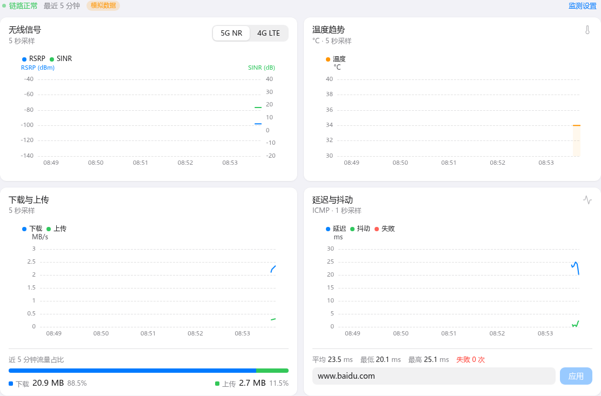

# 五分钟趋势与延迟监测

| 数据 | 默认周期 | 可调范围 | 保留量 | 存储 |
| --- | --- | --- | --- | --- |
| Ping RTT / Jitter | 1 秒 | 关闭或 1–300 秒 | 最近 5 分钟，最多 300 点 | 内存 |
| RSRP / SINR / 温度 | 5 秒 | 关闭或 2–300 秒 | 最近 5 分钟，最多 150 点 | 内存 |
| 下载 / 上传速率与流量占比 | 同上 | 同上 | 最近 5 分钟，最多 150 点 | 内存 |

- 默认 Ping `www.baidu.com`，可改为域名、IPv4 或 IPv6 地址。
- 总览监测区右上角 **监测设置** 可分别关闭或调整延迟监测、信号与流量采样，保存后立即生效并写入 `monitor.json`。面板会估算延迟监测的蜂窝流量：默认 1 秒间隔约 9.9 MB/天。
- 采集在设备后台运行，关闭网页后继续；重启程序后历史清空。关闭后台采样后，总览页打开期间仍随页面刷新记录信号与流量；关闭延迟监测后，“网络连接”改按模块拨号状态判断。
- RSRP 与 SINR 共用图表，分别使用左右坐标轴；温度单独绘图。读不到 4G 数据时隐藏相关读数与图例，SINR 为 0 的有效数据正常显示。
- 下载与上传按实际 AT 采样间隔计算速率，重复缓存不产生虚假的零速率。占比按近五分钟有效采样的上下行字节数计算，无流量时显示空占比。上下行方向见 [流量统计](traffic.md)。
- 单点 Jitter 为 `abs(RTT[n] - RTT[n-1])`，平均抖动为窗口内有效差值的算术平均。丢包、采样间断和窗口外的数据不参与配对。
- DNS 解析失败与 ICMP 超时分别记录。Ping 结果只表示目标的 ICMP 可达性。
