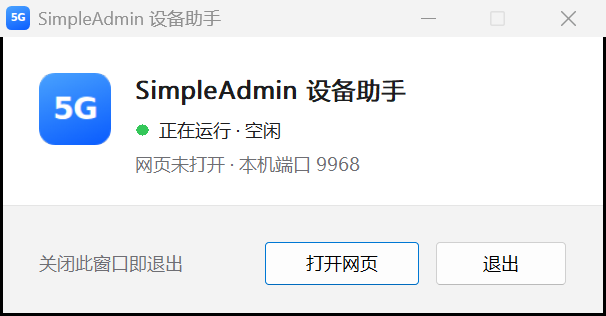
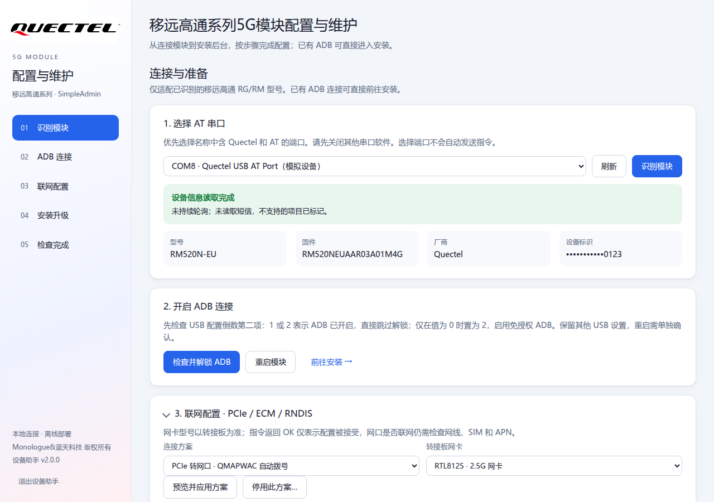

# Windows 设备助手

`SimpleAdmin-Setup.exe`（设备助手 2.1.0）用于连接模块、开启 ADB、配置联网方式以及安装或升级管理后台。适用于 Windows 10 / 11 x64。

## 运行方式

- 单文件 EXE 约 8 MB，用 Rust 编写，内置 ADB、模块程序和全部安装资源，不依赖 .NET 或 PowerShell，也不需要联网。对外分发只需这一个文件。
- EXE 在本机 `127.0.0.1` 的随机端口提供页面并用默认浏览器打开；页面只接受由 EXE 打开的浏览器窗口，其他网站无法调用。
- 运行时显示一个小窗口，标明运行状态，可随时“打开网页”或“退出”；关闭窗口即退出。再次双击会切换到已运行的窗口。
- 内置资源首次运行时解压到 `%LOCALAPPDATA%\SimpleAdmin\runtime`，校验后复用，升级时自动替换。操作报告保存在 `%LOCALAPPDATA%\SimpleAdmin\Reports`，可在页面中“查看报告”。

[深色界面](images/windows-installer-dark.png)

## 连接、配置与安装

侧边栏分为 **开始**（连接模块、安装与升级）和 **模块**（联网方式、设备信息、AT 指令）。已检测到 ADB 设备时直接进入“安装与升级”，否则从“连接模块”开始。

1. **连接模块**：选择 **Quectel USB AT Port**，点击 **识别**。先关闭占用串口的其他工具。
2. **开启 ADB → 检查并开启**：读取 USB 配置的倒数第二项，为 1 或 2 时跳过；为 0 时预览把它改为 2 的指令。VID 校验为移远 `2C7C`，PID 和其他 USB 参数保持原值，不计算或发送 ADB 密钥。
3. **联网方式**（可选）：选择 PCIe 转网口、ECM 或 RNDIS。已有 MPDN 规则 0 时先执行 `AT+QMAP="MPDN_RULE",0` 关闭，再用 `AT+QMAPWAC=1` 自动拨号。PCIe 方案按转接板选择 RTL8125 / RTL8168。
4. **安装与升级**：可打开开关自定义 HTTP 端口、Web 账号与密码、系统 root 密码。首次安装默认端口 80，账号和两种密码均为 `admin`；升级时关闭的选项保留原值。Web 账号支持 1–64 位字母、数字、点、下划线和短横线。
5. 等待安装和 HTTP 检查完成，点击 **打开管理页面**。网络配置如需重启，单独点击 **重启模块** 并确认，不会自动重启。

安全约定：

- 所有写入模块的串口操作都先弹窗列出完整指令；执行前重新核对模块身份，联网方案还会重新读取 MPDN 规则，与预览不一致时不执行。已执行的配置不会自动回滚。
- 密码通过 `adb exec-in` 的标准输入传递，不出现在命令行或日志中，也不在电脑上创建密码文件；模块只在 `/tmp` 暂存并校验。
- **设备信息** 按需读取，不持续轮询。**AT 指令** 支持最多 32 条逐行执行，遇错停止。不提供短信发送或删除指令。

## 适配型号

准备页开放 RM500Q、RM502Q、RM520N、RM521F、RG500Q、RG502Q、RG520N、RG520F、RG521F 系列。这是协议检查范围，不代表这些型号都已实机验证。

## HTTP 端口

- 端口保存在模块 `/usrdata/simpleadmin/http_port`，设备助手和管理后台“系统设置”共用。修改后立即切换监听，无需重启模块；新端口被占用或无法保存时保留原端口。
- 自定义端口后访问 `http://192.168.225.1:<端口>/`。设备助手的“打开管理页面”和“故障诊断”会自动读取保存的端口。
- 手动 ADB 转发：`adb forward tcp:18081 tcp:80`（右侧改为模块端口），然后打开 `http://127.0.0.1:18081`。通过 ADB 能打开只说明程序正常；通过模块 IP 访问还取决于网卡、路由和固件防火墙。
- 固件已有针对 `rmnet*` 接口的 TCP 80 DROP 规则时，启动时对自定义端口添加同样的限制，保持移动网络侧不可访问。

## 安装时的其他处理

- **升级 Go 版或旧版**：停止旧进程、替换程序和页面，保留有效的 Web 凭据、TTL、监测目标和 root 密码初始化标记。首次安装将 root 密码初始化为 `admin`，已有初始化标记时不重置。
- **bridge0 MAC**：安装时读取当前 bridge0 MAC 并保存到固件支持的 QCMAP 配置，使下次启动沿用当前地址；不生成新 MAC、不重启 QCMAP。读取失败或固件不支持时跳过。设置 `SIMPLEADMIN_FIX_BRIDGE0_MAC=0` 可禁用。
- 写入 `/usrdata` 时先将根目录挂为读写，写完恢复只读；内容相同不重复写入。
- 卸载脚本 `uninstall.bat` 和命令行安装脚本 `toolkit.ps1` 只保留在源码中，不随 EXE 分发。
